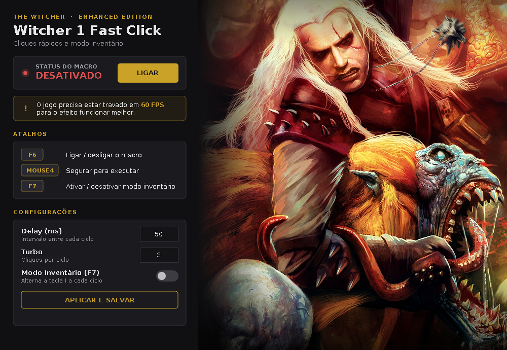
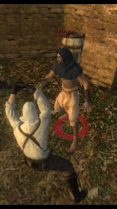

 <div align="center">

# ⚔️ The Witcher 1 — Fast Click

**Fast-click macro for *The Witcher: Enhanced Edition***

Exploits the opponent health-draining glitch and the item duplication glitch in Kaer Morhen, featuring a custom interface and global hotkeys.




</div>

---

## ✨ Features

**Witcher 1 Fast Click** sends mouse clicks at very high speeds while you hold **Mouse Button 4**. This allows you to consistently trigger two known glitches in the first Witcher game:

| Glitch | How the program helps |
| --- | --- |
| 🩸 **Drain an opponent's health** | Sends rapid, continuous clicks during combat, with adjustable clicks per cycle (Turbo) and interval (Delay). |
| 🎒 **Duplicate items (Kaer Morhen)** | **Inventory Mode (F7)** opens and closes the inventory while clicking in the same cycle to trigger the item duplication glitch early in the game. |

> [!IMPORTANT]
> These glitches work best when the game is **locked at 60 FPS**. See [Capping the Game at 60 FPS](#-capping-the-game-at-60-fps).

---

## 🎬 Demonstration

<!--
GIF TIPS
- Use a widescreen aspect ratio, such as 480x270 (16:9) or 480x240 (2:1).
- Keep each GIF 8–12 seconds long, at 15–20 FPS, looping, ideally under 3 MB.
- Save them in docs/gifs/ using the filenames below, or update the paths here.
-->

<table>
  <tr>
    <td align="center" width="33%">
      <br>
      <b>🩸 Health Drain</b><br>
      <sub>Hold Mouse Button 4 during combat</sub>
    </td>
    <td align="center" width="33%">
      <br>
      <b>🎒 Inventory Mode (F7)</b><br>
      <sub>Item duplication in Kaer Morhen</sub>
    </td>
    <td align="center" width="33%">
      <br>
      <b>🎛️ Interface and Hotkeys</b><br>
      <sub>Toggle with F6 and adjust Delay/Turbo</sub>
    </td>
  </tr>
</table>

---

## ⌨️ Hotkeys

| Key | Action |
| :---: | --- |
| **F6** | Toggles the macro on/off |
| **MOUSE 4** | Hold to execute rapid clicks (only works when the macro is **enabled**) |
| **F7** | Enables/disables **Inventory Mode** |

Hotkeys are **global**: they work while the game is in the foreground, without requiring you to click the program window.

---

## ⚙️ Settings

| Option | Description |
| --- | --- |
| **Delay (ms)** | Interval between each cycle. Lower values = faster execution. |
| **Turbo** | Number of clicks triggered during each cycle. |
| **Inventory Mode** | Each cycle presses the **I** key (inventory) for the duration of the delay, then clicks. |

Click **Apply and Save** to store your settings. They are saved in `config.properties`, which is also automatically saved when the program closes:

```properties
delay=50
turbo=3
```

> [!NOTE]
> Inventory Mode uses the **I** key, which is the game's default inventory shortcut. If you changed this key in The Witcher's settings, update `KeyEvent.VK_I` in `Witcher1FastClick.java`.

---

## 🚀 How to Use

### Requirements

- Windows 10 or 11
- [Java 17 or later](https://adoptium.net/) installed
- The Witcher: Enhanced Edition

### Step-by-step

1. Download `NildoWitcher1FastClick.jar` and place it in a folder of your choice. The program will create `config.properties` in that folder.
2. Launch it by **double-clicking** the JAR file or running it from the terminal:

   ```bash
   java -jar NildoWitcher1FastClick.jar
   ```

3. Launch the game and cap it at 60 FPS.
4. Press **F6** to enable the macro. The status indicator will turn green and display **ENABLED**.
5. Hold **Mouse Button 4** to trigger rapid clicks.
6. To duplicate items, press **F7** first, then use the macro as described above.

---

## 🎞️ Capping the Game at 60 FPS

The effectiveness of these glitches depends on the frame rate. Here are a few ways to cap the game at 60 FPS:

- **NVIDIA Control Panel / AMD Software:** Set an application-specific FPS limit for the game's executable.
- **RTSS (RivaTuner Statistics Server):** Set a frame rate limit for the game's profile.
- **V-Sync:** Enable V-Sync when using a 60 Hz monitor.

---

## 🛠️ Building from Source

This is an **Eclipse project** targeting Java 17. It uses the [JNativeHook 2.2.2](https://github.com/kwhat/jnativehook) library to capture keyboard and mouse input globally.

### Using Eclipse

1. Go to `File > Import > Existing Projects into Workspace` and select the project folder.
2. Update the path to `jnativehook-2.2.2.jar` under `Build Path > Libraries`. The `.classpath` file currently points to the author's Downloads folder.
3. Run `Witcher1FastClick` as a **Java Application**.

### Using the Command Line

```bash
javac -cp jnativehook-2.2.2.jar -d bin src/*.java
cp -r src/img bin/
java -cp "bin;jnativehook-2.2.2.jar" Witcher1FastClick
```

> On Linux/macOS, replace the `;` in the classpath with `:`.

### Project Structure

```text
Witcher1FastClick/
├── src/
│   ├── Witcher1FastClick.java   # Macro logic and window setup
│   ├── FastClickUI.java         # Theme and visual components (buttons, cards, switch)
│   ├── ArtPanel.java            # Striga artwork panel with gradients
│   └── img/Striga.jpg
├── docs/                        # README images and GIFs
├── config.properties
└── README.md
```

---

## ❓ Troubleshooting

**Clicks are not reaching the game.**

If the game is running as administrator, launch Fast Click as administrator as well. Windows may block simulated input from a process running with lower privileges.

**Mouse Button 4 does nothing.**

The macro must be **ENABLED** (F6) before you hold the button. Also, make sure your mouse has a side button and that it is mapped as "Mouse Button 4" in the manufacturer's software.

**`UnsupportedClassVersionError` appears.**

Your Java version is older than Java 17. Install Java 17 or later.

---

## ⚠️ Disclaimer

This is a fan-made project intended for **The Witcher Enhanced Edition Only**, with no commercial purpose. 
It is not affiliated with or endorsed by CD PROJEKT RED or Atari. *The Witcher* and its characters belong to their respective owners. 
Use this tool at your own risk.

## 🙏 Credits

- Created by **Nildo**
- [JNativeHook](https://github.com/kwhat/jnativehook) by Alexander Barker
- Artwork: Striga from *The Witcher*
